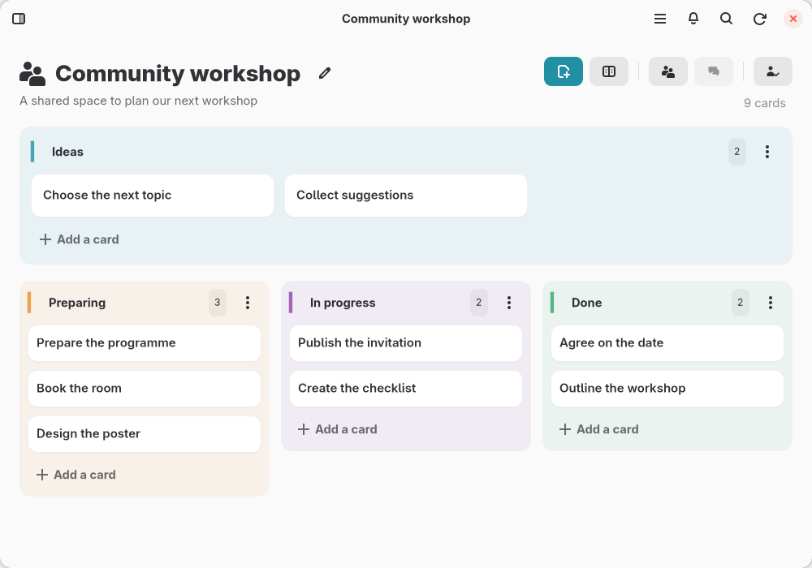

# Campbase

[Read in Catalan / Llegeix-ho en català](README.ca.md)

Campbase is a native kanban app for GNOME, built with GTK4 and libadwaita and
synchronized with **Nextcloud Deck**. Organize projects with cards and columns,
work with other people and keep the same boards available in the Android Deck app.

**Version: 0.1.7 — development preview.**
The latest downloadable release is **0.1.7**.

[Download the latest release](https://github.com/ceskfreixas/campbase/releases/latest) ·
[Source](https://github.com/ceskfreixas/campbase) ·
[Issues and suggestions](https://github.com/ceskfreixas/campbase/issues) ·
[Support the project](https://ceskfreixas.aixeta.cat/en/subscriptions)

<picture>
  <source media="(prefers-color-scheme: dark)" srcset="docs/catalog/screenshots/en-board-dark.png">
  
</picture>

[More screenshots in all six languages](docs/screenshots.md)

## Features

- Responsive boards, with an optional first column above the workflow and a
  configurable maximum of 1–6 columns per row. Done remains an ordinary column.
- Create, edit, drag, reorder, archive and restore cards. Search titles,
  descriptions and labels; create and rename boards and columns.
- Show archived cards independently in each column, and delete them individually
  or together from a separate archive section, with explicit confirmation.
  Changing the general setting in Preferences resets all column exceptions;
  each column can then be adjusted independently.
  Drag cards into an archive section, including an empty one, to archive them.
  Column name and color have separate actions. Delete boards you own from the sidebar.
- Undo a recent card move or archive from its confirmation message, including
  after synchronization. Drag archived cards to move them or restore them into
  the active area. Filter **Assigned to me** beside the board actions. Refreshes
  keep the visible card in place.
  Dragging keeps the viewport fixed. Column menus remain open when background
  updates arrive, and assignee avatars stay visible during synchronization.
  A compact comment count appears beside the title without adding another row.
  Campbase excludes emoji reactions from this count using cached background reads.
- Share boards with users on the same Nextcloud server. Choose initial read or
  edit access, manage edit/share/management permissions and remove direct access.
- Invite people on other servers using their federated ID when Deck 1.18 or
  later and federated sharing are enabled on both servers.
- Open Nextcloud Talk conversations from the board, message local members
  directly and explicitly invite them into a private board group chat.
- Assign cards to board members. See assignees on the board and edit them in the
  card dialog; assignment drafts are retained offline.
- React to comments with six familiar emojis. Campbase groups these readable
  emoji replies; mentioning the parent author uses Deck's existing notification
  system. Other clients display the replies as ordinary comments and count them
  as such. Notification delivery follows the recipient's Nextcloud settings.
- Comments with avatars, display names, usernames and local dates/times. The **@**
  picker inserts highlighted native Nextcloud mentions for board members. Authors
  can delete their own comments after confirmation.
- A notification inbox for mentions, reactions to your comments, assignments,
  due dates, boards shared with you and Talk messages. Open the referenced card
  section or conversation directly. Routine board activity and your own actions
  do not fill the inbox.
- Card labels and a native calendar with a local due time. The server-confirmation
  check includes the time, not just the calendar day.
- Rich descriptions with bold, italic, underline, strikethrough, headings, lists,
  quotes, code, links, embedded images, clipboard image paste and undo/redo.
- Editable project names; local descriptions, images and a 32-icon Adwaita picker.
  Sixteen column colors with subtle background tints.
- Automatic or manual synchronization, persistent offline cache, a durable outbox
  and explicit conflict review. **F5** synchronizes and refreshes notifications.
- GNOME Online Accounts integration, a configurable startup board/sidebar,
  system/light/dark themes and a discoverable keyboard shortcut reference.
  Preferences separates the theme under Appearance from the Board view controls.
- Catalan, Basque, Galician AGAL, Spanish, Aranese Occitan and English. Language
  changes apply immediately, preserve drafts and fall back to English.

## Collaboration and compatibility

Use the same Nextcloud account and server as other Deck clients. Sharing and
permission changes are explicit online operations. Card edits and assignment
changes use the durable outbox; with automatic sync disabled they wait for F5.
Campbase checks server permissions and confirms writes before clearing drafts.
The sharing dialog can copy a board link for existing authorised members;
copying it neither grants access nor makes the board public.

The connected account's canonical Nextcloud username and display name appear in
Preferences. Creation performed through Campbase is recorded locally; available
creation activity can supply authorship for other objects. Older objects without
that evidence show their server owner, or unavailable authorship. Campbase does
not guess a column's creator from its current board owner.

The inbox includes native Talk alerts and opens their conversation directly.
Activity reads provide authorship evidence only; they do not become inbox alerts.
Notifications follow the Deck and Talk settings enabled on the server;
Talk alerts reuse the existing notification feed without extra periodic requests. Optional feed failures do not discard card edits. Feeds refresh at
most once a minute during regular synchronization, or immediately from the inbox.
Card synchronization defaults to 45 seconds, with 30-second to 10-minute intervals
or manual mode available in Preferences. Campbase does not run a background daemon
when closed.

Federated board invitations go through the connected Nextcloud server; Campbase
never sends account credentials to the recipient's server. Enabling federation
requires an administrator and compatible Deck installations on both sides.

Messaging requires Nextcloud Talk with the v4 conversation API. Group chat
participants are managed independently in Talk: changing a board ACL does not
automatically add or remove chat participants. The board owner confirms the
initial local member list before creating a group; later membership changes,
including remote Talk participants, are managed in Talk. Drafts stay in the
private local cache. An uncertain send is not automatically retried. Messages
and notifications use Talk, not synthetic Deck comments. Chat polling only runs
while its dialog is open and does not block card synchronization.

## Install and run

Download **Campbase-0.1.7-x86_64.flatpak** from the [0.1.7 release](https://github.com/ceskfreixas/campbase/releases/tag/0.1.7).
This preview is for Linux x86_64 and requires Flatpak plus a Nextcloud account
with Deck configured in GNOME Online Accounts. Flatpak can download the GNOME
runtime from Flathub during installation; Campbase itself is not listed there.

```sh
flatpak install --user ./Campbase-0.1.7-x86_64.flatpak
flatpak run --user --branch=master cat.ceskfreixas.Campbase
```

GitHub bundles require manual Campbase updates. Download a newer bundle and
install it with `flatpak install --user --reinstall ./FILE.flatpak`; this retains
the application's data. See the [installation guide in six languages](docs/installation.md)
for checksum verification and updates.

To build from source:

```sh
flatpak-builder --user --install --force-clean build cat.ceskfreixas.Campbase.json
```

The manifest uses GNOME 50. It requests network/display/GPU access and D-Bus access
to GNOME Online Accounts and its settings panel. It does not request home-directory
access. The application ID is `cat.ceskfreixas.Campbase`.

## Development and testing

Requires Python 3.11+, PyGObject, GTK 4.14+, libadwaita 1.5+ and GNOME Online
Accounts. Debian packages include `python3-gi`, `gir1.2-gtk-4.0`, `gir1.2-adw-1`,
`python3-venv`, `gettext` and `gnome-online-accounts`. Mistune is pinned in the
Flatpak manifest with a SHA-256 checksum.

```sh
python3 scripts/compile_translations.py
python3 -m venv --system-site-packages .venv
.venv/bin/pip install -r requirements.txt
.venv/bin/python -m campbase --demo
.venv/bin/python -m unittest discover -s tests -v
```

Demo mode uses synthetic data in a temporary cache. It does not load real
credentials or write to Nextcloud. Native UI checks run on a dedicated Xvfb
display; collaboration write tests use an isolated local HTTP fixture:

```sh
xvfb-run -a env GDK_BACKEND=x11 CAMPBASE_LANGUAGE=ca PYTHONPATH=. .venv/bin/python tests/collaboration_smoke.py
```

See [CONTRIBUTING.md](CONTRIBUTING.md) for testing and translation guidance and
[protocol/design notes](docs/design.md) for implementation details. Current
version notes live in `campbase/releases.py`, appear in About and can be exported
with `python3 scripts/release_notes.py --language en`. Follow [AGENTS.md](AGENTS.md)
when preparing a new version.

## Data and privacy

- GNOME manages credentials. Campbase obtains them in memory through GOA and stores
  only the selected account ID in `$XDG_CONFIG_HOME/campbase/account.json`.
- The private cache/outbox is `$XDG_DATA_HOME/campbase/cache.sqlite3`. In Flatpak,
  application data lives below `~/.var/app/cat.ceskfreixas.Campbase/`.
- Authenticated requests require HTTPS outside loopback tests and do not follow
  redirects. Image downloads are restricted to the account's origin.
- Project descriptions, images and column colors are local presentation settings;
  Deck does not expose synchronized fields for them.
- Images use Deck attachments. Interrupted card creation is held for review;
  confirmed IDs and deterministic attachment names avoid duplicate creates/uploads.
- Descriptions use Markdown. Underline uses `<u>`, whose appearance depends on the
  other client. Campbase renders native text and never executes HTML.

Cards support file uploads and downloads through native GNOME file dialogs (up
to 64 MiB). Uncertain uploads require review before retrying. Board labels can
be renamed, recolored or deleted with permission and conflict checks. Recent
board deletions can be undone while Deck retains them; recovery also restores
local icons and colors. Each board's sidebar menu also opens its deleted cards
and columns. Recovery preserves archived cards and checks permissions and pending
changes; the trash is loaded only on demand. Permanent removal follows Deck's
server retention policy. Own Talk messages can be edited or deleted when the
server capabilities and time limits allow it. Conditional ETag reads use a
bounded account-specific cache; writes invalidate it and verification reads
always contact the server.

## License and credits

Campbase is free software under **GPL-3.0-or-later**. See [LICENSE](LICENSE) and
[NOTICE](NOTICE). Copyright © 2026 Cesk Freixas.

AppStream metadata is CC0-1.0. Dependencies retain their own licenses; Mistune's
BSD-3-Clause notice is included in the Flatpak. System icons come from Adwaita.
Campbase is an independent application, not an official Nextcloud or GNOME client.
