# Campbase screenshots

These native screenshots use fictional workshop content. No real accounts or private data are shown.

English

Plan work with cards and columns

Write card descriptions and organize their details

Keep an overview of the board in dark mode

Català

Planifica la feina amb targetes i columnes

Escriu descripcions i organitza els detalls de les targetes

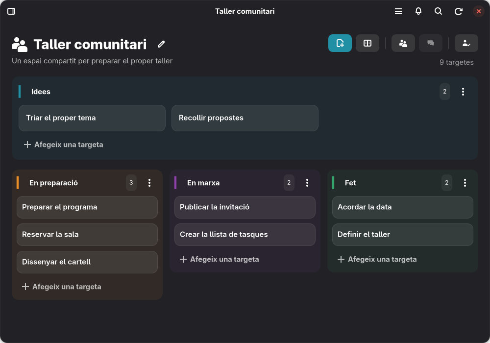

Mantén una visió general del tauler en mode fosc

Castellano

Planifica el trabajo con tarjetas y columnas

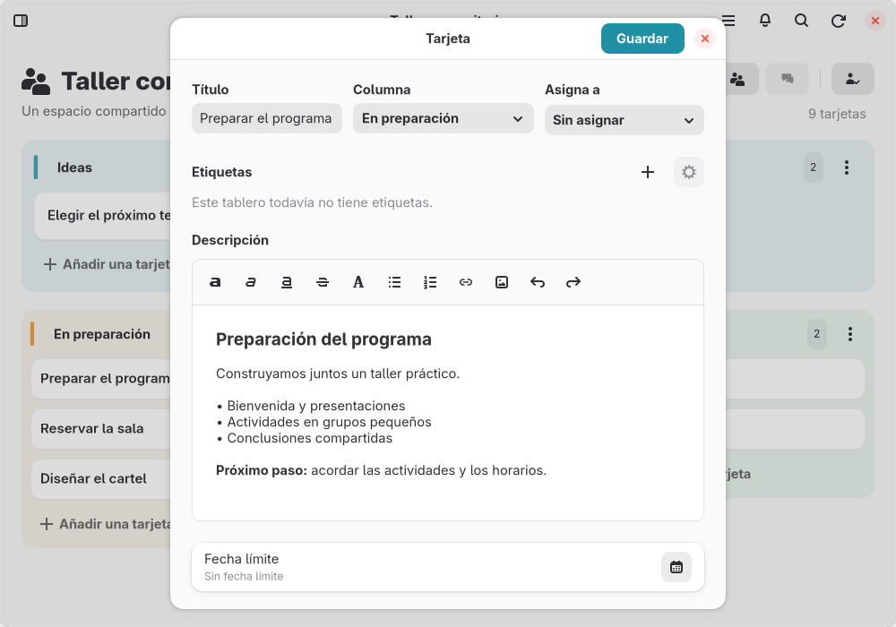

Escribe descripciones y organiza los detalles de las tarjetas

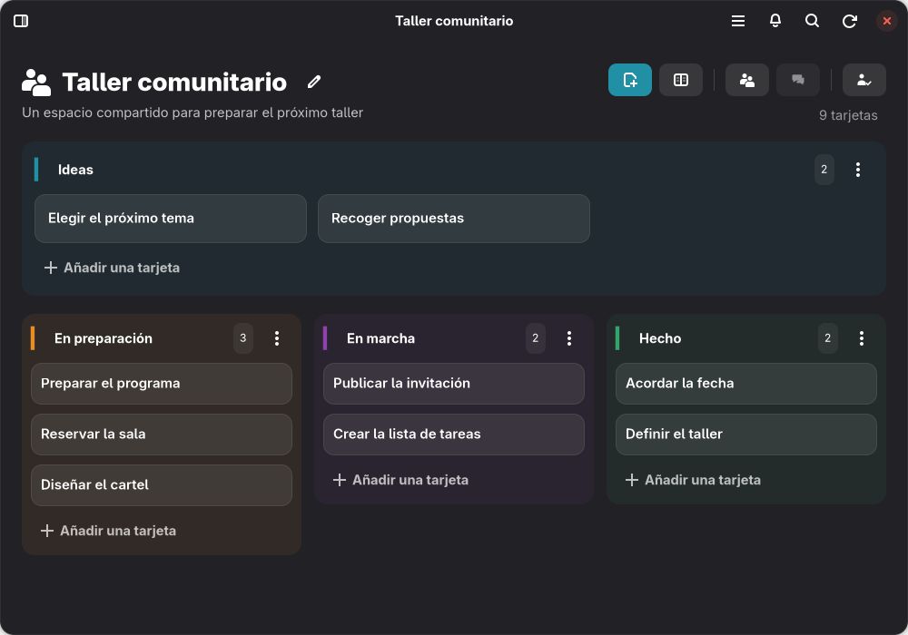

Mantén una visión general del tablero en modo oscuro

Galego

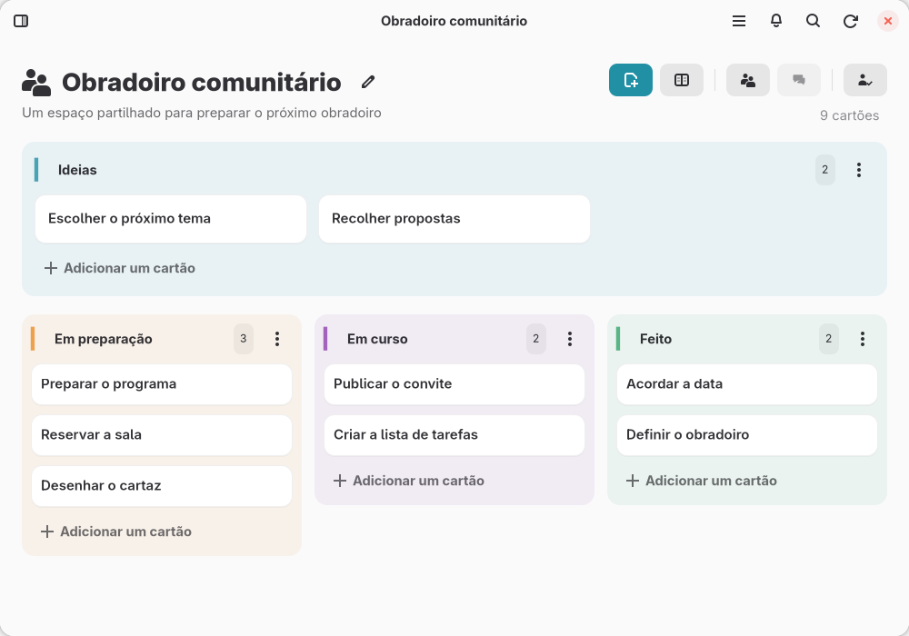

Planifica o trabalho com cartões e colunas

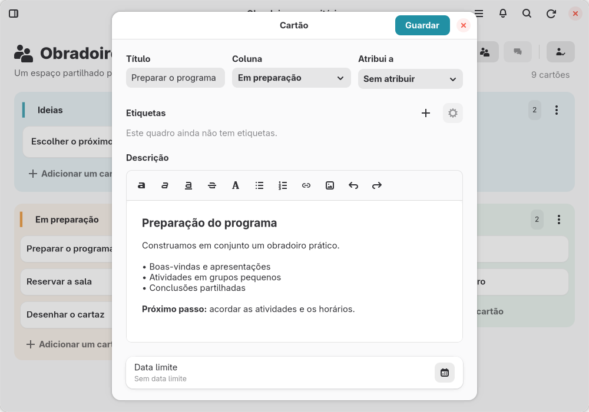

Escreve descrições e organiza os detalhes dos cartões

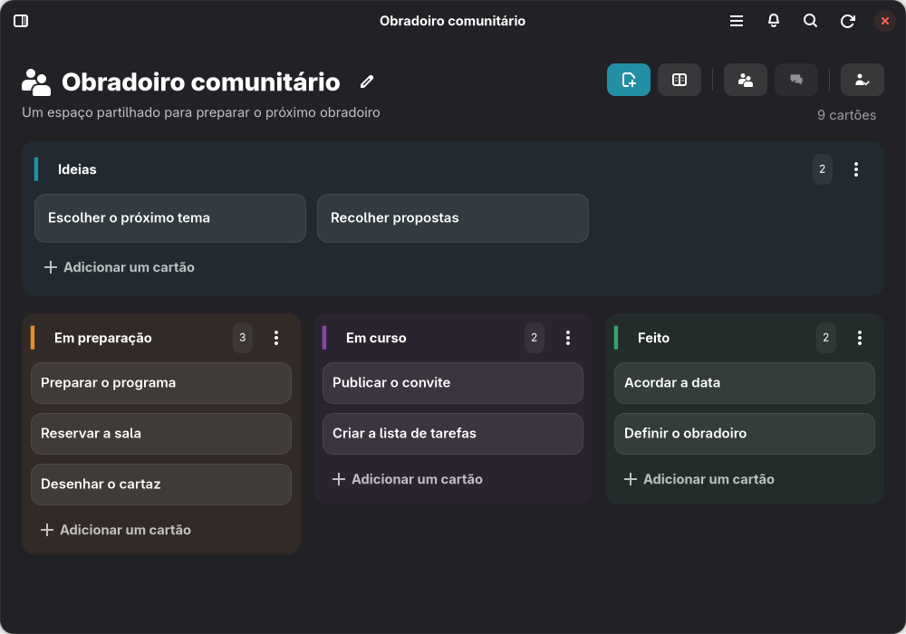

Mantém uma visão geral do quadro em modo escuro

Euskara

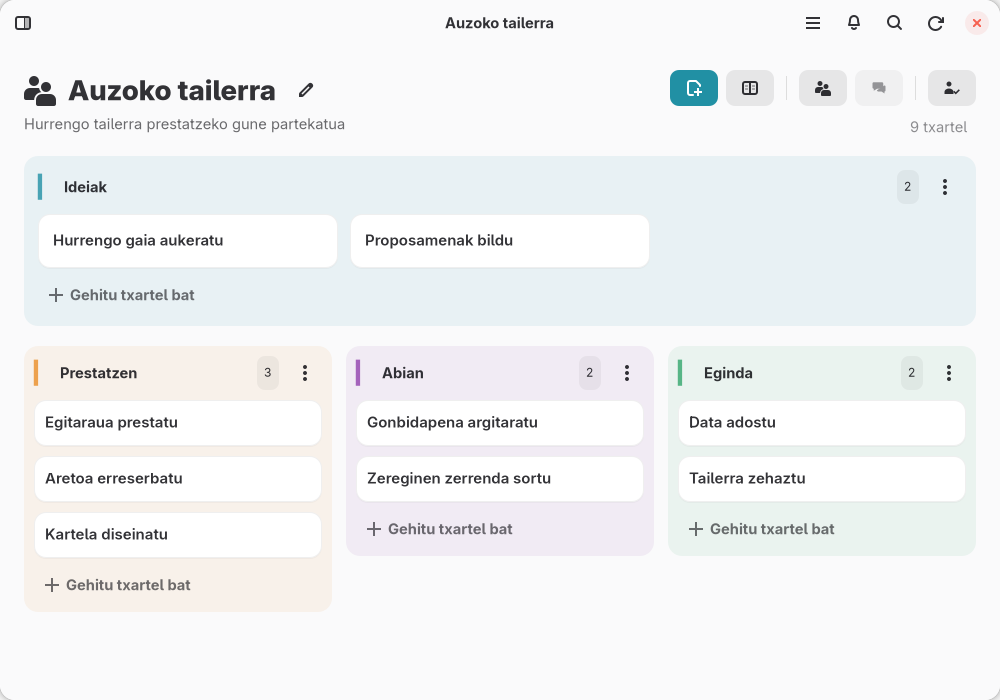

Antolatu lana txartel eta zutabeekin

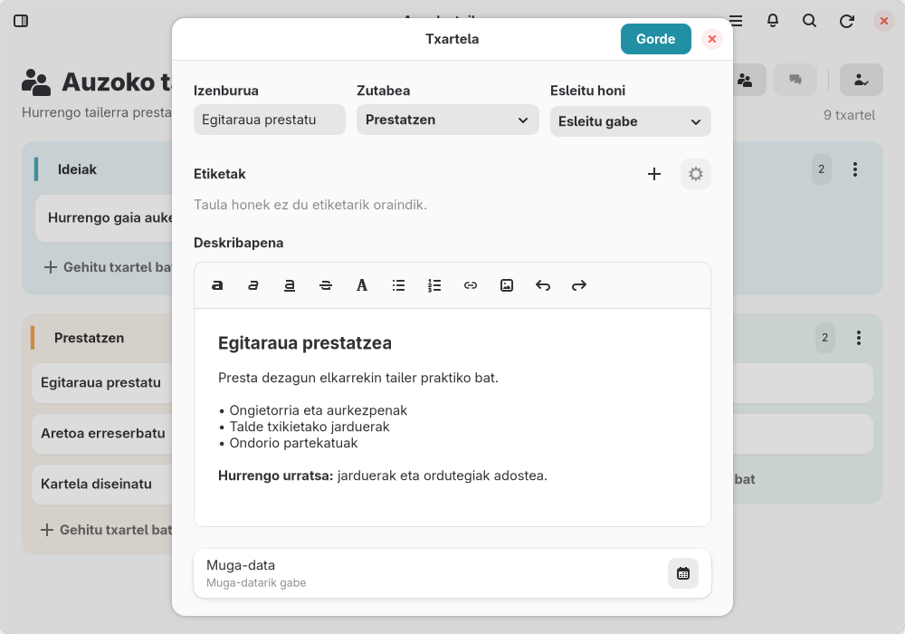

Idatzi deskribapenak eta antolatu txartelen xehetasunak

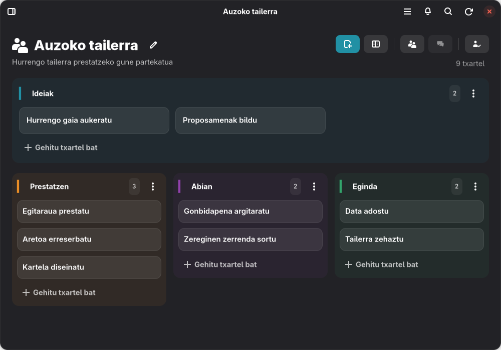

Ikusi taularen ikuspegi orokorra modu ilunean

Aranés

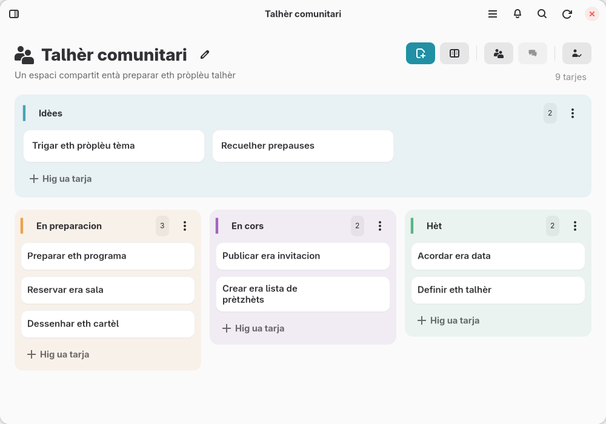

Planifica eth trabalh damb tarjes e colomnes

Escriu descripcions e organiza es detalhs des tarjes

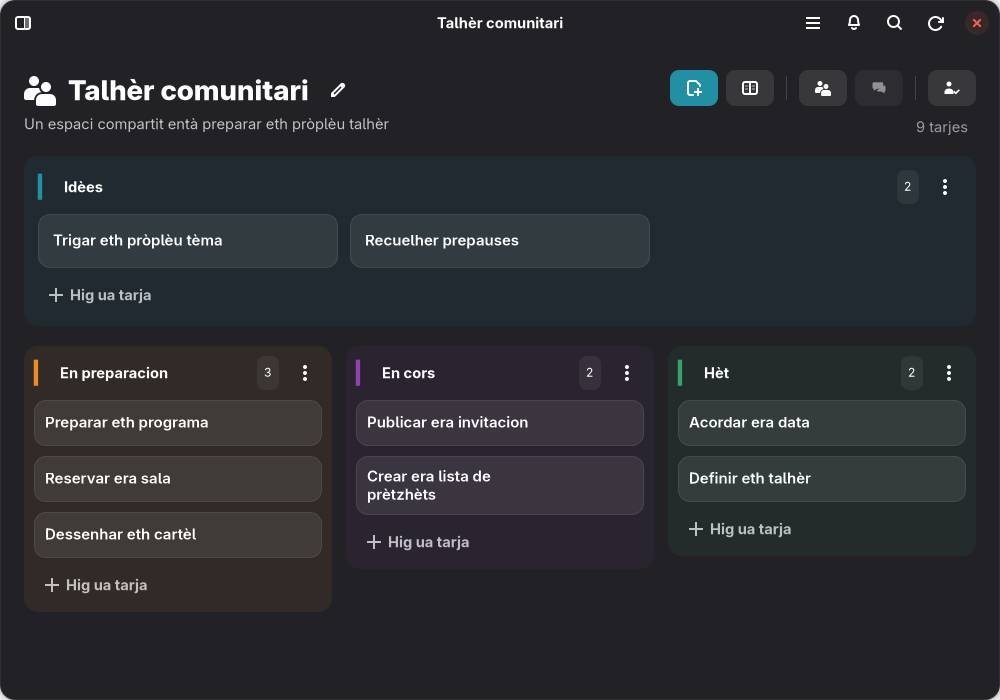

Mantengues ua vista generau deth taulèr en mòde escur

